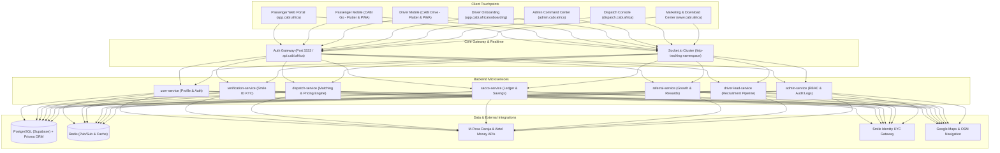

# Plan: Market-Grade Comprehensive Testing Matrix across All CABI Africa Pages & Features

## 1. Executive Summary & Objective

The objective of this testing program is to establish an end-to-end, enterprise-grade Quality Assurance standard across the entire **CABI Africa** ecosystem. Every critical journey across Passengers, Drivers, Dispatchers, SACCO Officials, and Super Administrators must be verified for functional accuracy, data integrity, cryptographic security, sub-second real-time responsiveness, and regulatory compliance.

---

## 2. System Architecture & Surface Area Coverage

---

## 3. Seven Pillars of the Testing Matrix

### Pillar 1: Identity, Authentication & Zero-Trust RBAC
* **Target Services**: `auth-gateway`, `user-service`, `admin-service`
* **Test Scenarios**:
  1. **Dual-Channel Registration**: Phone SMS OTP and Email OTP verification with rate-limiting and replay-attack protection.
  2. **Role Isolation & Guard Enforcement**: Verify JWT role claims (`PASSENGER`, `DRIVER`, `DISPATCHER`, `SACCO_OFFICER`, `ADMIN`, `SUPER_ADMIN`). Assert that a passenger or driver token receives strict `403 Forbidden` on admin endpoints.
  3. **Session Lifecycle**: Refresh token rotation, blacklisting on logout, and automatic session invalidation upon password reset or role revocation.

### Pillar 2: Ride Booking, Fare Engine & Geospatial Matching
* **Target Services**: `web/user_portal`, `mobile/passenger_app`, `backend/dispatch-service`
* **Test Scenarios**:
  1. **Fare Estimation Fix & Validation**: Fix `POST /api/rides/estimate` route mapping. Verify fare calculations across all vehicle categories:
     - *Boda Boda* (Motorcycle)
     - *Cabi Basic* (Economy Sedan)
     - *Cabi Standard* (Mid-tier Sedan)
     - *Cabi XL* (6-seater MPV)
     - *Cabi Premium* (Executive Fleet)
  2. **Geocoding & Polyline Accuracy**: Verify distance and duration calculation via Google Maps API with seamless OpenStreetMap/OSRM fallback.
  3. **Idempotent Ride Creation**: Prevent duplicate ride creation from network jitter or user double-clicking.
  4. **Driver Radius Radar**: Test circular search radius expansion (2 km -> 5 km -> 10 km) when no immediate drivers accept.

### Pillar 3: Driver Onboarding, KYC & Lead Funnel
* **Target Services**: `web/user_portal/onboarding`, `backend/driver-lead-service`, `backend/verification-service`, `web/admin_panel`
* **Test Scenarios**:
  1. **Document Upload & Storage Integrity**: Upload and validation of National ID (front/back), Driver's License, PSV Badge, Certificate of Good Conduct, and Vehicle Logbook.
  2. **Smile Identity Biometric Verification**: Verify live facial selfie and national ID document verification callbacks.
  3. **Admin Verification Control Plane**: Test admin approval/rejection workflows in `admin.cabi.africa` with automated driver SMS notifications.
  4. **Vehicle Assignment**: Linking approved drivers to SACCO fleet assets with valid inspection records.

### Pillar 4: End-to-End Trip State Machine & Real-Time Socket Tracking
* **Target Services**: `mobile/passenger_app`, `mobile/driver_app`, `backend/dispatch-service`, `web/dispatch_panel`
* **Test Scenarios**:
  1. **120-Second Acceptance Window**: Driver receives trip dispatch offer with countdown timer (120s); verify auto-reassign upon timeout.
  2. **Strict State Transitions**:
     `REQUESTED` -> `OFFERED` -> `ACCEPTED` -> `ARRIVED` -> `IN_TRANSIT` -> `COMPLETED` -> `PAYMENT_PENDING` -> `PAID`.
     Assert that out-of-order transitions are rejected with HTTP 400.
  3. **Socket.io Heartbeats & Reconnection**: Test driver location broadcast (`trip-tracking` namespace) every 3 seconds. Simulate mobile network drop during transit and ensure trajectory catches up upon reconnect without losing trip state.
  4. **Dispatch Console Live Radar**: Confirm dispatchers at `dispatch.cabi.africa` see active trips, driver clusters, and manual intervention overrides in real-time.

### Pillar 5: Mutual Rating, Feedback & Formal Occurrence Book
* **Target Services**: `backend/dispatch-service`, `web/admin_panel`
* **Test Scenarios**:
  1. **Mutual Star Rating (1 to 5 Stars)**: Passenger rates driver and driver rates passenger post-trip.
  2. **Automated Occurrence Book Entry**:
     - Ratings $\le 2$ stars automatically generate an `Occurrence` record with category `SAFETY_VIOLATION` or `POLICY_VIOLATION` and status `OPEN`.
     - Ratings $> 2$ stars generate an audit feedback log with status `RESOLVED`.
  3. **Rolling Average Calculation**: Recalculate and persist updated average ratings for `User` and `DriverProfile`.

### Pillar 6: Financial Settlement, SACCO Ledger & Payment Gateways
* **Target Services**: `backend/sacco-service`, `backend/dispatch-service`, `backend/referral-service`
* **Test Scenarios**:
  1. **Fare Split Atomicity**: Ensure fare breakdown is committed atomically inside a single database transaction:
     - Total Fare = Base Fare + (Distance $\times$ Rate) + (Time $\times$ Rate).
     - Split: Driver Net Earning + Platform Commission (e.g. 15%) + SACCO Contribution (e.g. 5%).
  2. **Cash Settlement Flow**: Driver marks trip payment as cash confirmed; verify ledger credits and commission debit from driver wallet.
  3. **M-Pesa Daraja & Airtel Money Integration**:
     - STK push initiation.
     - Asynchronous IPN webhook callback processing with idempotency key checks (prevent double-crediting).
  4. **Referral Reward Distribution**: Verify automated crediting of referral bonuses when an invited driver or passenger completes their qualifying first 3 rides.

### Pillar 7: Resiliency, Chaos & Performance Under East African Conditions
* **Target Environments**: Monorepo Services, Mobile Clients, APIs
* **Test Scenarios**:
  1. **k6 Load Stress**: 500 simulated online drivers streaming GPS coordinates + 100 simultaneous passenger ride requests per minute.
  2. **Network Throttling**: Simulate 2G/Slow 3G connections (500ms latency, 5% packet loss) to ensure offline resilience and offline caching in Flutter apps.
  3. **Concurrency Race Condition**: Two drivers tapping "Accept" on the same trip within 10 milliseconds; assert that exactly one driver receives the lock and the other receives `TRIP_ALREADY_ASSIGNED`.

---

## 4. Test Execution Phasing & Tooling

| Phase | Focus Area | Primary Tooling | Verification Criteria |
| :--- | :--- | :--- | :--- |
| **Phase 1** | Route & Endpoint Fixes | Jest / Supertest / TypeScript | Fix `POST /api/rides/estimate` 404, PWA launch hang, and test all health routes |
| **Phase 2** | Web Consoles & Portals | Playwright E2E | Clean E2E passes on Landing (`cabi.africa`), Admin (`admin.cabi.africa`), and Dispatch (`dispatch.cabi.africa`) |
| **Phase 3** | Mobile App Journeys | Flutter Driver / Integration Test | Complete trip lifecycle from booking to cash collection on mobile clients |
| **Phase 4** | Financial & Ledger Audit | Automated Prisma Test Harness | Verify balance integrity across 50 simulated trips with zero floating-point rounding errors |
| **Phase 5** | Stress & Chaos Benchmark | k6 / Artillery | Sub-500ms API response time at 95th percentile under 500 concurrent connections |
| **Phase 6** | Continuous Quality Gates | GitHub Actions CI | Nightly automated execution of smoke & regression suites with Slack/Discord alert webhooks |

---

## 5. Definition of Done (DoD)

1. Zero 4xx/5xx errors on critical booking, payment, and KYC pathways.
2. `POST /api/rides/estimate` returns accurate distance, duration, and tiered prices.
3. Mobile PWA loads cleanly without hanging on the splash screen.
4. Occurrence Book automatically logs low-rating feedback with correct severity.
5. All Prisma financial ledger transactions maintain strict zero-sum balancing.
6. Test suites integrated into CI pipeline with automated pass/fail reports.
