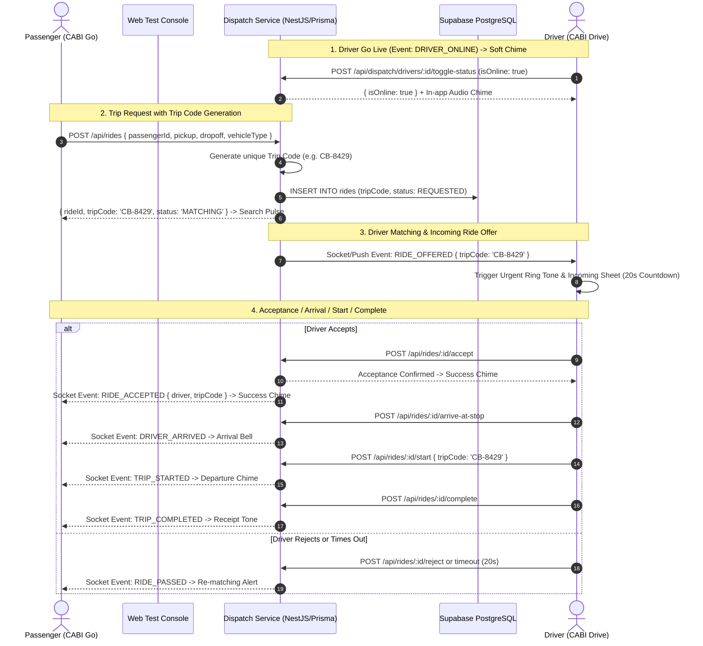

# Implementation Plan: Special 'Trip Code' & End-to-End Notification Sound System

## 1. Overview & Objective
Implement a unique, human-readable **Trip Code** (format: `CB-XXXX`, e.g. `CB-7429`) for every ride to enable instant recognition, passenger-driver verification, and support tracking.
In parallel, implement an end-to-end **Notification & Audio Alert Engine** spanning the backend dispatch lifecycle, mobile applications (CABI Drive & CABI Go), and web management console.

### Key Capabilities:
1. **Special Trip Code**:
   - Unique alphanumeric code `CB-XXXX` generated upon ride creation.
   - Stored in PostgreSQL `rides.tripCode` with database index.
   - Displayed prominently on passenger booking panels, active trip cards, driver acceptance sheets, and receipt views.
   - Usable as a 4-digit verification code to securely start the ride.
2. **Notification Event Lifecycle (12 Key Triggers)**:
   - `DRIVER_ONLINE`: Driver toggles status to Online.
   - `DRIVER_OFFLINE`: Driver toggles status to Offline.
   - `PASSENGER_PREPARING`: Passenger selects pickup/destination & views vehicle options.
   - `DRIVER_MATCHED`: Ride successfully assigned to a nearby driver.
   - `RIDE_OFFERED`: Incoming ride request ringtone & modal presented to driver.
   - `RIDE_ACCEPTED`: Driver accepts the ride; passenger notified with arrival ETA.
   - `RIDE_REJECTED`: Driver declines ride; backend re-enters matching queue.
   - `RIDE_PASSED`: Assignment timeout expires (20s); passenger informed of rerouting.
   - `DRIVER_ARRIVED`: Driver reaches pickup location.
   - `TRIP_STARTED`: Verification confirmed; trip officially begins.
   - `TRIP_COMPLETED`: Destination reached; fare finalized and receipt generated.
   - `TRIP_CANCELLED`: Ride cancelled by either passenger or driver.
3. **Audio Alert Architecture & User-Defined Customization**:
   - **In-App Audio Service**: Plays distinct auditory cues matched to the event severity (Informational chime, Affirmative chime, Urgent ring, Alert ding).
   - **User Settings Modal**: Sound theme selector (Modern Chime, Soft Bell, Digital Pulse, Minimal), volume slider, and individual toggles per notification event.
   - **Web Console Audio**: Synthesizer audio engine (Web Audio API) for live browser-based testing.

---

## 2. Architectural Blueprint

---

## 3. Phased Implementation Roadmap

### Phase 1: Database Schema & Trip Code Generator
- Add column `tripCode` varchar(16) to PostgreSQL `rides` table in Supabase.
- Update Prisma Schema in `libs/backend/database/prisma/schema.prisma`.
- Implement `generateTripCode(): string` helper in `backend/dispatch-service/src/ride/ride.service.ts`:
  - Generates alphanumeric `CB-XXXX` ensuring unicity.
- Include `tripCode` in `createRide`, `acceptRide`, `getCurrentRide`, and ride responses.

### Phase 2: Dispatch Service Notification Event Stream
- Enhance `TripTrackingGateway` and `DispatchGateway` in `dispatch-service` to broadcast enriched payload with `tripCode`, `eventType`, and sound trigger metadata.
- Ensure all 12 events emit standardized socket payloads:
  - `{ event: 'DRIVER_ONLINE', sound: 'CHIME_ONLINE', data: ... }`
  - `{ event: 'RIDE_OFFERED', sound: 'RING_OFFER', tripCode: 'CB-XXXX', data: ... }`
  - `{ event: 'RIDE_ACCEPTED', sound: 'CHIME_ACCEPTED', tripCode: 'CB-XXXX', data: ... }`
  - `{ event: 'DRIVER_ARRIVED', sound: 'CHIME_ARRIVED', tripCode: 'CB-XXXX', data: ... }`
  - `{ event: 'TRIP_STARTED', sound: 'CHIME_START', tripCode: 'CB-XXXX', data: ... }`
  - `{ event: 'TRIP_COMPLETED', sound: 'CHIME_COMPLETE', tripCode: 'CB-XXXX', data: ... }`
  - `{ event: 'TRIP_CANCELLED', sound: 'CHIME_CANCELLED', tripCode: 'CB-XXXX', data: ... }`

### Phase 3: Mobile Apps Audio Alert & Sound Settings (CABI Drive & CABI Go)
- Create `SoundNotificationService` utility:
  - Audio preset profiles (`Modern`, `Bell`, `Digital`).
  - Native haptic feedback integration (`HapticFeedback.mediumImpact()`, `HapticFeedback.vibrate()`).
  - System sound triggers (`SystemSound.play(SystemSoundType.alert)`).
- Create `NotificationSoundSettingsModal` in user preferences:
  - Toggle sound on/off per event type.
  - Preview sound theme buttons.
- Display `tripCode` prominently on:
  - Driver `IncomingRideDialog` (e.g. `Trip: CB-7429`).
  - Driver active ride header.
  - Passenger `SearchingPanel`, `DriverAssignedPanel`, and `RideReceiptPanel`.

### Phase 4: Passenger Test Console Audio & Trip Code UI
- Update `passenger_test_console.html` with:
  - Real-time `tripCode` badge display (`CB-XXXX`).
  - Web Audio API synthesizer chimes for all 12 events.
  - Audio toggle switch on the console.

### Phase 5: Verification & Obsidian Documentation
- Run end-to-end simulation in test console and verify sound playback.
- Update Obsidian Vault documentation in `D:\IBN\iBN-Cabi Vault\01-System Architecture & Engineering\Trip Code & Notification Audio Architecture.md`.
