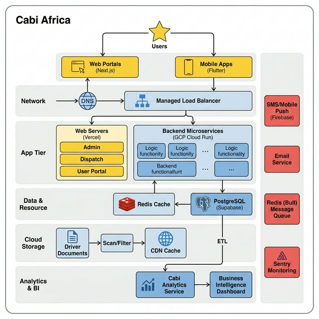
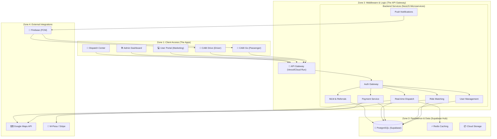

# 🏗️ Cabi Africa: Core System Architecture

**Last Updated:** 2026-04-11  
**Version:** 1.1.0  
**Status:** 🟢 Production Finalized (.africa)

---

## 🌍 1. System Overview

Cabi Africa is a high-scale, multi-platform ride-hailing ecosystem built specifically for the African market. It follows a **micro-frontend** and **microservices** architectural pattern, managed within a high-performance **Nx Monorepo**.

### **📌 System Design Deep-Dive (Reference Model)**

Based on modern enterprise standards, the Cabi Africa infrastructure handles four distinct layers:

1.  **Access Layer (Users & Networking)**: Traffic is routed through **DNS** and **Load Balancers** to ensure high availability across Web (Marketing, Admin, Dispatch) and Mobile (Passenger, Driver) clients.
2.  **App & Logic Layer**:
    *   **Frontend**: Hosted on **Vercel** for optimal Next.js performance and localized CDN caching.
    *   **Backend**: **20+ NestJS Microservices** (Ride, Dispatch, Payment, etc.) running as containers on **GCP Cloud Run**.
3.  **Persistence & Resource Layer**:
    *   **Data Hub**: **Supabase (PostgreSQL)** for transactional data (trips, users, ledger).
    *   **Live Reflex (Cache)**: **Redis** for driver geolocations (near-instant search) and **Bull Queues** for background tasks (payouts, emails).
    *   **Storage Pipeline**: Driver document uploads (IDs, Licenses) flow through an OCR/Check scan into **Supabase Storage** and are delivered globally via **CDN**.
4.  **Analytics & Support Layer**:
    *   **BI & Analytics**: Real-time data flows into the **Cabi Analytics Service** for business intelligence reporting.
    *   **Support Services**: Dedicated sidebars for **Firebase Push (FCM)**, **SMS Gateways**, and **Sentry Monitoring** for system observability.
*   **Passengers**: Via the **CABI Go** Flutter app and **[app.cabi.africa](https://app.cabi.africa)**.
*   **Drivers**: Via the **CABI Drive** Flutter app and **[app.cabi.africa/onboarding](https://app.cabi.africa/onboarding)**.
*   **Administrators**: Via **[admin.cabi.africa](https://admin.cabi.africa)**.
*   **Dispatchers**: Via **[dispatch.cabi.africa](https://dispatch.cabi.africa)**.

---

## 🛠️ 2. Technology Stack

### **Frontend & Mobile**
| Component | Technology | Target |
| :--- | :--- | :--- |
| **Mobile Apps** | Flutter (Dart 3.x) | iOS & Android |
| **PWA / Web Portals** | Next.js 14+ (App Router) | All Browsers |
| **Styling** | Tailwind CSS v4 | Universal UI Consistency |
| **State Management** | Riverpod (Mobile), Context/Zustand (Web) | Distributed State |

### **Backend Microservices**
| Component | Technology | Purpose |
| :--- | :--- | :--- |
| **Framework** | NestJS (Node.js 20+) | Modular, Type-safe APIs |
| **Monorepo Manager** | Nx | Parallel builds & code sharing |
| **ORM** | Prisma | Type-safe database access |
| **Real-time** | Socket.io / WebSockets | Live tracking & dispatch |

### **Infrastructure (The Foundation)**
| Component | Provider | Role |
| :--- | :--- | :--- |
| **Database** | Supabase (PostgreSQL 15+) | Primary Ledger & User Data |
| **Authentication** | Supabase Auth (GoTrue) | JWT-based Secure Access |
| **Caching** | Redis (Managed) | Real-time session state |
| **File Storage** | Supabase Storage (S3-compatible) | ID Photos, Documents |

---

## 📊 3. High-Level Architecture Diagram

---

## 🔄 4. Core System Workflows

### **A. Real-time Ride Matching**
1.  **Passenger App** requests a ride via the **Ride Match Service**.
2.  **Dispatch Service** queries **Redis** to find active drivers within a 3km radius.
3.  **Google Maps API** calculates the ETA and route distance.
4.  **Socket.io** sends a real-time "Ride Offer" to the Driver's phone.
5.  On acceptance, the **Ride Match Service** creates a trip record in **Supabase**.

### **B. Driver Onboarding & Verification**
1.  **Prospective Driver** registers via the **User Portal**.
2.  Document photos (ID, License) are uploaded directly to **Supabase Storage**.
3.  **Verification Service** notifies the **Admin Panel**.
4.  Admin reviews and approves. **User Service** updates the status to `ACTIVE`.
5.  **MLM Service** triggers referral commission payouts to the "Sponsor."

### **C. Payment & Payouts**
1.  Trip completes; **Payment Service** calculates the final fare.
2.  Transaction is initiated via **M-Pesa** or **Stripe**.
3.  On success, the **Ledger** in **PostgreSQL** is updated.
4.  Earnings are split between the Driver, the Platform, and the Referral Upline.

---

## 🚀 5. Deployment Zones (Hosting Recommendations)

| App Type | Recommended Host | Rationale |
| :--- | :--- | :--- |
| **Web Apps** | **Vercel** | Best Next.js optimization & global edge network. |
| **Backend APIs** | **GCP Cloud Run** | Best for scale-to-zero microservices and monorepos. |
| **Mobile Updates** | **Shorebird** | Instant "over-the-air" updates for the Flutter apps. |
| **Push Notifications** | **Firebase (FCM)**| Native reliability for waking up sleeping devices. |

---

## 🛡️ 6. Reliability & Security
*   **Data Integrity**: Managed via Prisma Transactions and PostgreSQL ACID properties.
*   **Availability**: Multi-region data replication (via Supabase) and stateless service redundancy (Google Cloud Run).
*   **Security**: JWT tokens for all API calls, Rate Limiting on the Gateway, and Encrypted PII storage.

---

**Generated by Antigravity AI for Cabi Africa Engineering Team.**
