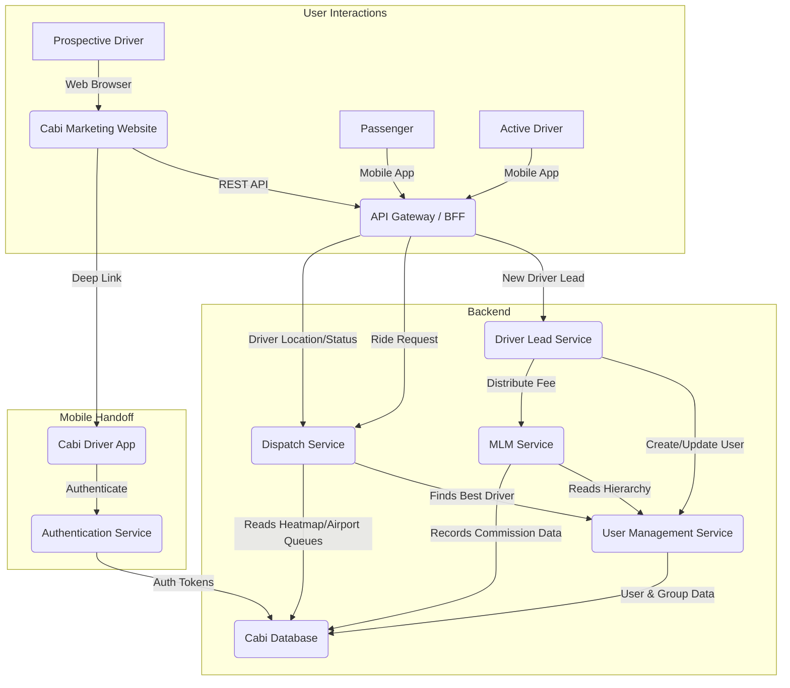
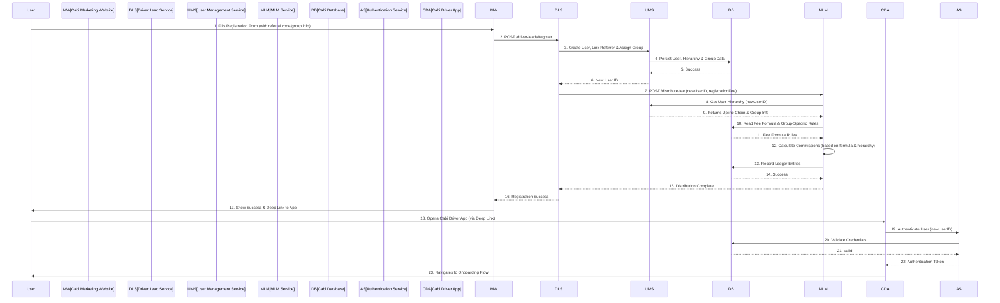

# Cabi Marketing Website Architecture Document

## 1. Introduction

This document outlines the overall project architecture for the Cabi Marketing Website, including backend systems, shared services, and non-UI specific concerns. Its primary goal is to serve as the guiding architectural blueprint for AI-driven development, ensuring consistency and adherence to chosen patterns and technologies.

**Relationship to Frontend Architecture:**
If the project includes a significant user interface, a separate Frontend Architecture Document will detail the frontend-specific design and MUST be used in conjunction with this document. Core technology stack choices documented herein (see "Tech Stack") are definitive for the entire project, including any frontend components.

### 1.1. Starter Template or Existing Project

For this greenfield project, a modern web framework like Next.js (React) is provisionally assumed to meet performance (PageSpeed > 85) and SEO requirements, and to facilitate the development of the multi-step registration form. The final technology stack will be explicitly defined and confirmed in the "Tech Stack" section of this document.

**Rationale:**
Based on the PRD, this is a new greenfield project for a web-based marketing and registration portal. However, it must integrate deeply with the existing Cabi-Flutter mobile ecosystem, particularly for user account creation and the hand-off to the driver app. The choice of a starter template or framework is critical for meeting the high-performance and scalability requirements (NFR1, NFR4) while ensuring a smooth developer experience.

A modern, server-side rendering (SSR) or static site generation (SSG) framework is highly recommended to achieve the PageSpeed goals. Options like Next.js (React), Nuxt.js (Vue), or Astro would be strong candidates.

### 1.2. Change Log

| Date         | Version | Description              | Author  |
| :----------- | :------ | :----------------------- | :------ |
| 2025-12-01   | 1.1     | Added MLM & Subgroup architecture | Winston |
| 2025-12-01   | 1.0     | Initial document creation| Winston |

## 2. High Level Architecture

**Rationale:**
This section lays the architectural groundwork for the Cabi Marketing Website, integrating it within the broader Cabi ecosystem. The primary goal is to balance the specific needs of a high-performance marketing site (SEO, fast loading) with the robust, scalable backend infrastructure required for driver registration and existing Cabi services. The design emphasizes modularity, leveraging existing components where possible, and an API-first approach to ensure seamless integration and future extensibility.

### 2.1. Technical Summary
The Cabi Marketing Website will employ a hybrid architectural approach, combining a performant, server-side rendered (SSR) or static site generated (SSG) frontend with an existing microservices-based backend. A new Driver Lead Service will manage the initial registration funnel, integrating seamlessly with existing User Management and Authentication services. A new MLM Service will handle referral and fee distribution logic across a hierarchical driver structure. This architecture supports the PRD's goals of increased driver acquisition while enabling a scalable MLM system
A new **Dispatch Service** will be introduced to manage all real-time ride matching, driver scoring, and operational logistics like airport queues.

### 2.2. High Level Overview
1.  **Architectural Style:** A hybrid style, with the marketing website built using a modern web framework (e.g., Next.js) enabling SSR/SSG, integrating with the existing Cabi microservices backend. New backend logic for driver lead capture, MLM fee distribution, and driver group management will reside in dedicated services.
2.  **Repository Structure:** The marketing website and any new associated backend services will be developed within the existing Cabi monorepo, leveraging Nx workspaces for consistent tooling and code sharing across applications and libraries. 3.  **Service Architecture:** Core functionalities (User Management, Authentication) will be provided by existing Cabi backend services. New dedicated services will be created for: `Driver Lead Service` (web registration), `MLM Service` (referral hierarchy and fees), and a `Dispatch Service` (ride matching and logistics).
4.  **Primary User Interaction Flow:**
    *   A prospective driver lands on the marketing website, potentially with a referral code.
    *   They browse content and initiate registration, optionally providing a referral code.
    *   Basic information is submitted to the `Driver Lead Service`.
    *   The `Driver Lead Service` interacts with the `User Management Service` to create a new "Prospect" user and link them to their referrer (upline) in the driver hierarchy.
    *   Upon successful registration and payment (handled by a separate payment service), the `Driver Lead Service` notifies the `MLM Service`.
    *   The `MLM Service` calculates and records the commission/fee distribution for the sponsor and potentially multiple upline levels based on a configurable formula.
    *   The website then deep-links the user to the Cabi Driver App to complete the full onboarding process.
    *   Once active, drivers interact with the `Dispatch Service` to receive ride offers, which are assigned based on a dynamic scoring model.
5.  **Key Architectural Decisions:**
    *   **Decoupled Frontend:** The marketing website is distinct from the core mobile apps, allowing for specialized web performance optimization and independent deployment.
    *   **API-First Integration:** All new and existing services will expose well-defined RESTful APIs to ensure clear contracts and enable robust integration.
    *   **Centralized MLM Logic:** All logic related to driver hierarchy, subgroups, and commission calculations is encapsulated within a dedicated `MLM Service` to maintain separation of concerns.

### 2.3. High Level Project Diagram


### 2.4. Architectural and Design Patterns
*   **Architectural Style Patterns:**
    *   **Existing Microservices Backend with Serverless/SSR Frontend:** This approach combines the scalability and modularity of the existing microservices architecture for core business logic with the performance and SEO benefits of a server-side rendered (SSR) or statically generated (SSG) frontend for the marketing website.
        *   *Rationale:* Optimizes for both frontend performance (critical for marketing and SEO) and backend robustness, allowing independent evolution of the marketing site.
    *   **API Gateway:** Provides a unified entry point, handles cross-cutting concerns like authentication, rate limiting, and request routing.
*   **Code Organization Patterns:**
    *   **Repository Pattern:** Applied within backend services to abstract data access logic.
        *   *Rationale:* Promotes domain-driven design, enhances testability, and provides flexibility for future data storage changes.
    *   **Modular Design (Frontend & Backend):** Organize the marketing website and new backend services into cohesive, loosely coupled modules.
        *   *Rationale:* Improves maintainability, facilitates collaboration, and allows for easier scaling of individual components.
*   **Communication Patterns:**
    *   **RESTful APIs:** The primary mode of synchronous communication between the marketing website (frontend) and backend services.
        *   *Rationale:* A widely adopted standard, easy to consume, and well-suited for request-response interactions.
    *   **Event-Driven Communication (Internal Backend):** For asynchronous interactions and updates between backend services (e.g., `Driver Lead Service` publishing a `DriverRegistered` event, which the `MLM Service` subscribes to).
        *   *Rationale:* Decouples services, improves system responsiveness, and supports eventual consistency for background processes, aligning with microservice best practices.

## 3. Tech Stack

**Rationale:**
This section defines the definitive technology stack for the Cabi Marketing Website and its associated backend services. The choices are guided by the project's non-functional requirements (performance, scalability, security), the existing monorepo structure (Nx, TypeScript), and industry best practices for modern web applications. The goal is to create a cohesive, maintainable, and high-performing stack that enables developer productivity.

Since no specific technical preferences were provided, these recommendations are based on creating a robust and modern system. Each choice is critical and will be the single source of truth for all development.

### 3.1. Cloud Infrastructure

*   **Provider:** AWS (Amazon Web Services) is recommended.
    *   *Rationale:* AWS offers a mature and comprehensive suite of services that align well with the proposed architecture, including excellent support for serverless functions, managed databases, and global content delivery, which are key to meeting the project's performance and scalability goals. Alternatives include Google Cloud Platform (GCP) and Microsoft Azure.
*   **Key Services:**
    *   **Compute:** AWS Lambda (for serverless backend logic, e.g., the Driver Lead Service, MLM Service).
    *   **Frontend Hosting:** Vercel (for Next.js) or AWS Amplify/S3+CloudFront. Vercel is highly recommended for optimal Next.js performance.
    *   **Database:** Amazon RDS for PostgreSQL (for relational data like user profiles).
    *   **API Gateway:** Amazon API Gateway (to manage and secure backend APIs).
    *   **CDN:** Amazon CloudFront (for caching static assets and ensuring fast global delivery).
*   **Deployment Regions:** A primary region like `us-east-1` (N. Virginia) is a common starting point, with the option to expand to other regions as the user base grows.

### 3.2. Technology Stack Table

| Category | Technology | Version | Purpose | Rationale |
| :--- | :--- | :--- | :--- | :--- |
| **Language** | TypeScript | `~5.3.3` | Primary development language | Provides static typing for robust, maintainable code; already in use in the monorepo. |
| **Monorepo Tool** | Nx | `~18.0.0` | Manage project workspaces | Already in use; excellent for code sharing, task running, and enforcing project structure. |
| **Runtime** | Node.js | `~20.11.0` | Backend JavaScript runtime | LTS version ensures stability; consistent language (TS/JS) across frontend and backend. |
| **Web Framework** | Next.js | `~14.1.0` | Frontend and web server | Enables high-performance SSR/SSG for SEO and fast page loads, ideal for a marketing site. |
| **Backend Framework**| NestJS | `~10.3.0` | Backend API framework | A structured, modular framework for building efficient and scalable Node.js APIs. Works well with Nx and TypeScript. |
| **Styling** | Tailwind CSS | `~3.4.1` | CSS Framework | Utility-first approach for rapid, custom UI development with excellent performance. |
| **Database** | PostgreSQL | `15` | Primary relational database | Powerful, reliable, and well-suited for structured data like user and driver information. |
| **ORM** | Prisma | `~5.10.0` | Database toolkit for TS/Node.js| Provides a type-safe and intuitive way to interact with the database. |
| **Deployment** | Docker | `~25.0` | Containerization | Ensures consistent development and production environments for backend services. |
| **Infrastructure** | AWS CDK | `~2.127.0`| Infrastructure as Code (IaC) | Define cloud infrastructure using TypeScript, keeping the entire project in a single language. |

## 4. Data Models

**Rationale:**
This section defines the core data entities required for the driver acquisition funnel. The design is based on the PRD, which specifies the need to capture prospective driver information and create a "Prospect" account. The proposed structure separates core user identity from driver-specific data, promoting a clean, scalable, and maintainable design that integrates with the existing Cabi user ecosystem.

### 4.1. User

**Purpose:** Represents a core identity within the Cabi ecosystem. This central model holds authentication-related information and is linked to various role-specific profiles (e.g., Driver, Passenger). A new account will be created in this table for each driver prospect.

**Key Attributes:**
*   `id`: `UUID` - Unique primary key for the user.
*   `email`: `String` - The user's email address (must be unique).
*   `passwordHash`: `String` - Hashed password for the user. This may be null initially if the prospect signs up via a passwordless flow, to be set later.
*   `createdAt`: `DateTime` - Timestamp of user creation.

**Relationships:**
*   Has one `DriverProfile` (a User can be a Driver).

### 4.2. DriverProfile

**Purpose:** Stores all information related to a driver's application journey and their professional details once active. This model will be created with a status of `PROSPECT` upon successful submission of the marketing website's registration form.

**Key Attributes:**
*   `id`: `UUID` - Unique primary key for the profile.
*   `userId`: `UUID` - A foreign key linking directly to the `User` model.
*   `firstName`: `String` - The prospect's first name.
*   `lastName`: `String` - The prospect's last name.
*   `phone`: `String` - The prospect's phone number.
*   `city`: `String` - The city where the prospect intends to drive.
*   `applicationStatus`: `Enum` - The current status of the driver's application. (e.g., `PROSPECT`, `PENDING_DOCUMENTS`, `ACTIVE`, `REJECTED`).
*   `referralCode`: `String` - A unique code assigned to the driver for referrals (can be nullable).
*   `createdAt`: `DateTime` - Timestamp of profile creation.

**Relationships:**
*   Belongs to one `User`.

## 5. Components

### 5.1. Component List

*   **5.1.1. Cabi Marketing Website (Frontend)**
    *   **Responsibility:** Serve engaging marketing content, provide information to prospective drivers, and facilitate the initial web-based driver registration form. Handle user interaction and seamlessly hand off to the mobile app for further onboarding. This is the user-facing web application.
    *   **Key Interfaces:**
        *   User-facing web pages (static/SSR/SSG generated content).
        *   `POST /api/register-lead` (API endpoint within Next.js for submitting prospect data to `Driver Lead Service`).
        *   Deep linking to Cabi Driver App (via specific URL schemes or universal links).
    *   **Dependencies:** `Driver Lead Service` (via API Gateway), CDN for serving static assets.
    *   **Technology Stack:** Next.js (React), Tailwind CSS.
    *   *For detailed frontend architecture, see: [Cabi Marketing Website Frontend Architecture Document](ui-architecture.md)*

*   **5.1.2. Driver Lead Service (Backend)**
    *   **Responsibility:** Handle the initial driver registration process originating from the marketing website. Validate incoming prospect data, interact with the `User Management Service` to create/update user entities, and notify the `MLM Service` upon successful registration.
    *   **Key Interfaces:**
        *   `POST /driver-leads/register`: Accepts prospect registration data.
    *   **Dependencies:** `User Management Service`, `MLM Service`.
    *   **Technology Stack:** NestJS (Node.js/TypeScript), Prisma (ORM).

*   **5.1.3. MLM Service (Backend)**
    *   **Responsibility:** Manages MLM logic, including referral tracking, driver group/subgroup hierarchies, and the calculation and distribution of registration fees based on admin-configured formulas.
    *   **Key Interfaces:**
        *   `POST /mlm/distribute-fee`: Triggered upon a new driver registration to distribute the fee.
        *   `GET /admin/mlm/formula`: Retrieves the current fee distribution formula.
        *   `PUT /admin/mlm/formula`: Updates the fee distribution formula.
        *   `GET /admin/driver-groups`: Manages driver group hierarchies.
    *   **Dependencies:** `User Management Service`, `Cabi Database`.
    *   **Technology Stack:** NestJS (Node.js/TypeScript), Prisma (ORM).

*   **5.1.4. Existing User Management Service (Backend)**
    *   **Responsibility:** Centralized management of all user accounts and their hierarchical relationships (e.g., parent/child links for MLM) across Cabi platforms.
    *   **Key Interfaces:** (Assumed existing APIs, potentially with new endpoints for hierarchy management)
        *   `POST /users`: Creates a new `User` record.
        *   `PUT /users/:id`: Updates an existing `User` record.
        *   `POST /driver-groups`: Manages driver group hierarchies.
    *   **Dependencies:** `Cabi Database`.
    *   **Technology Stack:** (Assumed existing - e.g., Node.js/TypeScript, Java, Python).

*   **5.1.5. Existing Authentication Service (Backend)**
    *   **Responsibility:** Manages user authentication and authorization.
    *   **Key Interfaces:** (Assumed existing APIs)
        *   `POST /auth/login`: Authenticates a user.
    *   **Dependencies:** `Cabi Database`, `User Management Service`.
    *   **Technology Stack:** (Assumed existing - e.g., Node.js/TypeScript, Java, Python).

*   **5.1.6. API Gateway (Infrastructure)**
    *   **Responsibility:** Acts as a unified, secure entry point for all external client requests to backend services.
    *   **Key Interfaces:** Routes traffic to `Driver Lead Service`, `MLM Service`, `User Management Service`, etc.
    *   **Dependencies:** All backend services.
    *   **Technology Stack:** AWS API Gateway.

### 5.2. Component Diagrams

```mermaid
graph LR
    subgraph Frontend
        A[Cabi Marketing Website]
    end

    subgraph Backend Services (Existing & New)
        direction LR
        B(API Gateway) --> C(Driver Lead Service)
        C --> D(User Management Service)
        D --> E(Authentication Service)
        C -- Notifies --> I(MLM Service)
        I -- Reads Hierarchy --> D
        D -- Reads/Writes --> F[Cabi Database]
        E -- Reads/Writes --> F
        I -- Records Data --> F
    end

    subgraph Mobile Application
        G[Cabi Driver App]
    end

    A -- (1) Submit Registration --> B
    B -- (2) Route to --> C
    C -- (3) Create User & Assign Group/Upline --> D
    D -- (4) Store User, Group & Hierarchy --> F
    C -- (5) Trigger Fee Distribution --> I
    I -- (6) Calculate & Record Commissions --> F
    A -- (7) Deep Link --> G
    G -- (8) Authenticate User --> E
```
*   **Flow:**
    1.  User submits registration form on the Marketing Website.
    2.  Request goes through the API Gateway and is routed to the new Driver Lead Service.
    3.  The Driver Lead Service interacts with the existing User Management Service to create a new user, link them to their referrer, and assign them to an appropriate driver group.
    4.  User Management Service stores this information in the Cabi Database.
    5.  The `Driver Lead Service` notifies the `MLM Service` to handle fee distribution.
    6.  The `MLM Service` reads the hierarchy, calculates commissions, and records them in the database.
    7.  The Marketing Website deep links the user to the Cabi Driver App.
    8.  The Driver App authenticates the user.

## 6. External APIs

**Rationale:**
This section identifies and details external API integrations necessary for the Cabi Marketing Website to meet its functional and non-functional requirements.

### 6.1. Google reCAPTCHA (for Bot Protection)

*   **Purpose:** To protect the driver registration form on the marketing website from automated bot submissions and spam.
*   **Documentation:** `https://developers.google.com/recaptcha`
*   **Base URL(s):** Verification API endpoint: `https://www.google.com/recaptcha/api/siteverify`
*   **Authentication:** Requires a Site Key (frontend) and a Secret Key (backend).
*   **Integration Notes:** The `Driver Lead Service` will verify the reCAPTCHA token before processing registration.

## 7. Core Workflows

**Rationale:**
This section illustrates key system workflows using sequence diagrams to clarify component interactions.

### 7.1. Driver Registration & Commission Workflow

This diagram outlines the refined user journey, including the MLM commission calculation and driver group assignment.



## 8. REST API Spec

**Rationale:**
This section defines the OpenAPI 3.0 specification for the new backend services.

Here is the OpenAPI 3.0 specification for the `Driver Lead Service` and `MLM Service`:

```yaml
openapi: 3.0.0
info:
  title: Cabi Backend Services API
  version: 1.0.0
  description: API for managing driver prospect registrations and MLM fee distribution.
servers:
  - url: /api/v1
    description: Base path for services behind API Gateway

paths:
  /driver-leads/register:
    post:
      summary: Register a new driver prospect
      operationId: registerDriverLead
      requestBody:
        description: Driver prospect registration data
        required: true
        content:
          application/json:
            schema:
              $ref: '#/components/schemas/RegistrationRequest'
      responses:
        '201':
          description: Successful registration.
          content:
            application/json:
              schema:
                $ref: '#/components/schemas/RegistrationSuccessResponse'
        '400':
          description: Invalid input or user already exists.
          content:
            application/json:
              schema:
                $ref: '#/components/schemas/ErrorResponse'
  /admin/mlm/formula:
    get:
      summary: Get the current MLM fee distribution formula
      operationId: getMlmFormula
      responses:
        '200':
          description: The current MLM formula.
          content:
            application/json:
              schema:
                $ref: '#/components/schemas/MlmFormula'
    put:
      summary: Update the MLM fee distribution formula
      operationId: updateMlmFormula
      requestBody:
        description: The new MLM formula
        required: true
        content:
          application/json:
            schema:
              $ref: '#/components/schemas/MlmFormula'
      responses:
        '200':
          description: Formula updated successfully.
          content:
            application/json:
              schema:
                $ref: '#/components/schemas/MlmFormula'
  /admin/driver-groups:
    get:
      summary: List all driver groups
      operationId: listDriverGroups
      responses:
        '200':
          description: A list of driver groups, potentially hierarchical.
          content:
            application/json:
              schema:
                type: array
                items:
                  $ref: '#/components/schemas/DriverGroup'
    post:
      summary: Create a new driver group
      operationId: createDriverGroup
      requestBody:
        description: Driver group creation data
        required: true
        content:
          application/json:
            schema:
              $ref: '#/components/schemas/DriverGroupCreate'
      responses:
        '201':
          description: Driver group created successfully.
          content:
            application/json:
              schema:
                $ref: '#/components/schemas/DriverGroup'
  /admin/driver-groups/{groupId}:
    get:
      summary: Get a specific driver group by ID
      operationId: getDriverGroupById
      parameters:
        - name: groupId
          in: path
          required: true
          schema: { type: string, format: uuid }
      responses:
        '200':
          description: The requested driver group.
          content:
            application/json:
              schema:
                $ref: '#/components/schemas/DriverGroup'
    put:
      summary: Update a driver group
      operationId: updateDriverGroup
      parameters:
        - name: groupId
          in: path
          required: true
          schema: { type: string, format: uuid }
      requestBody:
        description: Driver group update data
        required: true
        content:
          application/json:
            schema:
              $ref: '#/components/schemas/DriverGroupUpdate'
      responses:
        '200':
          description: Driver group updated successfully.
          content:
            application/json:
              schema:
                $ref: '#/components/schemas/DriverGroup'
    delete:
      summary: Delete a driver group
      operationId: deleteDriverGroup
      parameters:
        - name: groupId
          in: path
          required: true
          schema: { type: string, format: uuid }
      responses:
        '204':
          description: Driver group deleted successfully.
  /admin/driver-groups/{groupId}/drivers:
    post:
      summary: Assign a driver to a group
      operationId: assignDriverToGroup
      parameters:
        - name: groupId
          in: path
          required: true
          schema: { type: string, format: uuid }
      requestBody:
        description: The ID of the driver to assign to the group
        required: true
        content:
          application/json:
            schema:
              $ref: '#/components/schemas/DriverAssignmentRequest'
      responses:
        '200':
          description: Driver assigned successfully. Returns the updated group.
          content:
            application/json:
              schema:
                $ref: '#/components/schemas/DriverGroup'
  /admin/driver-groups/{groupId}/drivers/{driverId}:
    delete:
      summary: Unassign a driver from a group
      operationId: unassignDriverFromGroup
      parameters:
        - name: groupId
          in: path
          required: true
          schema: { type: string, format: uuid }
        - name: driverId
          in: path
          required: true
          schema: { type: string, format: uuid }
      responses:
        '204':
          description: Driver unassigned successfully.
  /dispatch/requests:
    post:
      summary: Request a new ride
      operationId: requestRide
      requestBody:
        description: Ride request details from the passenger.
        required: true
        content:
          application/json:
            schema:
              $ref: '#/components/schemas/RideRequest'
      responses:
        '201':
          description: Ride request accepted and is now searching for a driver.
          content:
            application/json:
              schema:
                $ref: '#/components/schemas/RideResponse'
        '400':
          description: Invalid request data.
          content:
            application/json:
              schema:
                $ref: '#/components/schemas/ErrorResponse'
  /dispatch/offers/{offerId}/respond:
    post:
      summary: Respond to a ride offer
      operationId: respondToRideOffer
      parameters:
        - name: offerId
          in: path
          required: true
          schema: { type: string, format: uuid }
      requestBody:
        description: Driver's response to the ride offer (accept or reject).
        required: true
        content:
          application/json:
            schema:
              $ref: '#/components/schemas/RideOfferResponseRequest'
      responses:
        '200':
          description: Response successfully recorded.
          content:
            application/json:
              schema:
                $ref: '#/components/schemas/RideOfferResponseConfirmation'
        '404':
          description: Offer not found or has expired.
          content:
            application/json:
              schema:
                $ref: '#/components/schemas/ErrorResponse'

components:
  schemas:
    RegistrationRequest:
      type: object
      required: [email, firstName, lastName, phone, city, recaptchaToken]
      properties:
        email: { type: string, format: email }
        firstName: { type: string }
        lastName: { type: string }
        phone: { type: string }
        city: { type: string }
        recaptchaToken: { type: string }
    RegistrationSuccessResponse:
      type: object
      properties:
        userId: { type: string, format: uuid }
        message: { type: string }
    MlmFormula:
      type: object
      properties:
        rules:
          type: array
          items:
            type: object
            properties:
              recipient: { type: string, enum: [sponsor, upline, company] }
              value: { type: number }
              type: { type: string, enum: [fixed, percentage] }
    ErrorResponse:
      type: object
      properties:
        code: { type: string }
        message: { type: string }
    DriverGroup:
      type: object
      properties:
        id: { type: string, format: uuid }
        name: { type: string }
        description: { type: string }
        parentId: { type: string, format: uuid, nullable: true }
        subgroups:
          type: array
          items:
            $ref: '#/components/schemas/DriverGroup'
        drivers:
          type: array
          items:
            type: string
            format: uuid
    DriverGroupCreate:
      type: object
      properties:
        name: { type: string }
        description: { type: string }
        parentId: { type: string, format: uuid, nullable: true }
    DriverGroupUpdate:
      type: object
      properties:
        code: { type: string }
        message: { type: string }
```

## 9. Database Schema

**Rationale:**
This section translates the conceptual `Data Models` into concrete database schemas using Prisma SDL.

Here are the Prisma schema definitions for the `User`, `DriverProfile`, `DriverGroup`, and new MLM-related models:

```prisma
// prisma/schema.prisma

generator client {
  provider = "prisma-client-js"
}

datasource db {
  provider = "postgresql"
  url      = env("DATABASE_URL")
}

enum ApplicationStatus {
  PROSPECT
  PENDING_DOCUMENTS
  PENDING_APPROVAL
  ACTIVE
  REJECTED
  INACTIVE
}

enum MlmRecipient {
  SPONSOR
  UPLINE
  COMPANY
}

enum MlmRuleType {
  FIXED
  PERCENTAGE
}

model User {
  id            String                  @id @default(uuid())
  email         String                  @unique
  passwordHash  String?
  resetToken    String?                 @unique
  resetTokenExpires DateTime?
  createdAt     DateTime                @default(now())
  updatedAt     DateTime                @updatedAt

  // Two-Factor Authentication
  isTwoFactorEnabled Boolean              @default(false)
  twoFactorSecret    String?
  recoveryCodes      String[]             // Stores hashed recovery codes

  deviceTokens          String[]
  lastActiveAt          DateTime?
  // Forgot Email Recovery
  forgotEmailOtp          String?
  forgotEmailOtpExpires   DateTime?

  driverProfile DriverProfile?
  
  sponsored     DriverProfile[]         @relation("Referrals") // Drivers referred by this user
  
  // Ledger entries where this user is the new driver or the recipient of a fee
  newDriverLedgers RegistrationFeeLedger[] @relation("NewDriverEntries")
  recipientLedgers RegistrationFeeLedger[] @relation("RecipientEntries")

  adminAuditLogs AuditLog[] @relation("AdminAuditLogs")
  loginHistory LoginHistory[]
  
  @@map("users")
}

model DriverProfile {
  id                String            @id @default(uuid())
  userId            String            @unique
  firstName         String
  lastName          String
  phone             String
  city              String
  applicationStatus ApplicationStatus @default(PROSPECT)
  referralCode      String?           @unique
  referrerId        String?           // ID of the user who is the referrer
  groupId           String?           // ID of the driver's group
  createdAt         DateTime          @default(now())
  updatedAt         DateTime          @updatedAt

  user       User         @relation(fields: [userId], references: [id], onDelete: Cascade)
  referrer   User?        @relation("Referrals", fields: [referrerId], references: [id], onUpdate: NoAction, onDelete: NoAction)
  group      DriverGroup? @relation(fields: [groupId], references: [id])
  
  @@map("driver_profiles")
}

model DriverGroup {
  id          String  @id @default(uuid())
  name        String
  description String?
  
  parentId    String?
  parent      DriverGroup?  @relation("Subgroups", fields: [parentId], references: [id], onUpdate: NoAction, onDelete: NoAction)
  subgroups   DriverGroup[] @relation("Subgroups")

  drivers     DriverProfile[]

  @@map("driver_groups")
}

model MlmFeeFormula {
  id          Int          @id @default(autoincrement())
  recipient   MlmRecipient
  value       Float
  ruleType    MlmRuleType  @map("rule_type")
  uplineLevel Int?         // e.g., 1 for direct sponsor, 2 for sponsor's sponsor (null for company)
  description String?
  createdAt   DateTime     @default(now())

  @@map("mlm_fee_formulas")
}

model RegistrationFeeLedger {
  id                String   @id @default(uuid())
  newDriverId       String   // The ID of the newly registered driver
  recipientId       String   // The ID of the user receiving the fee portion
  amount            Float
  registrationFee   Float    // Total registration fee before distribution
  processedAt       DateTime @default(now())

  newDriver User @relation("NewDriverEntries", fields: [newDriverId], references: [id], onUpdate: NoAction, onDelete: NoAction)
  recipient User @relation("RecipientEntries", fields: [recipientId], references: [id], onUpdate: NoAction, onDelete: NoAction)

  @@map("registration_fee_ledgers")
}

model LoginHistory {
  id        String   @id @default(uuid())
  userId    String
  ipAddress String
  userAgent String?
  location  String?
  createdAt DateTime @default(now())
  reportedAt DateTime?
  reviewedAt DateTime?

  user User @relation(fields: [userId], references: [id], onDelete: Cascade)

  @@map("login_history")
}

model AuditLog {
  id         String   @id @default(uuid())
  adminId    String // The ID of the admin performing the action
  actionType String // e.g., 'USER_IMPERSONATION_START', 'USER_SUSPENDED'
  targetId   String? // The ID of the entity being acted upon (e.g., a user's ID)
  targetType String? // The type of the entity (e.g., 'USER', 'LOGIN_HISTORY')
  details    Json? // Contextual details, e.g., { ipAddress: '1.2.3.4' }
  createdAt  DateTime @default(now())

  admin User @relation("AdminAuditLogs", fields: [adminId], references: [id], onUpdate: NoAction, onDelete: NoAction)

  @@map("audit_logs")
}
```

## 10. Source Tree

**Rationale:**
This section outlines the proposed project folder structure, integrating the new components into the existing Nx monorepo.

```plaintext
project-root/
├── apps/
│   ├── marketing-website/        # Next.js application
│   ├── driver-lead-service/      # NestJS registration API
│   ├── mlm-service/              # NestJS MLM fee distribution and group management API
│   ├── admin-panel/              # Existing admin panel
│   └── ...                       # Other existing apps
├── libs/
│   ├── shared/
│   │   ├── interfaces/           # Common TypeScript interfaces
│   │   └── ...
│   └── ...
└── ...
```

## 11. Infrastructure and Deployment
(No changes from previous version)

## 12. Error Handling Strategy
(No changes from previous version)

## 13. Coding Standards
(No changes from previous version)

## 14. Test Strategy and Standards
(No changes from previous version)

## 15. Security
(No changes from previous version)

## 16. Checklist Results Report
(This section should be re-evaluated based on these significant architectural changes).

## 17. Next Steps
(This section should be re-evaluated based on these significant architectural changes).

## 18. Related Documents

*   **Cabi Marketing Website Frontend Architecture Document:** For a detailed breakdown of the frontend design, patterns, and implementation specifics, refer to [docs/ui-architecture.md](ui-architecture.md).