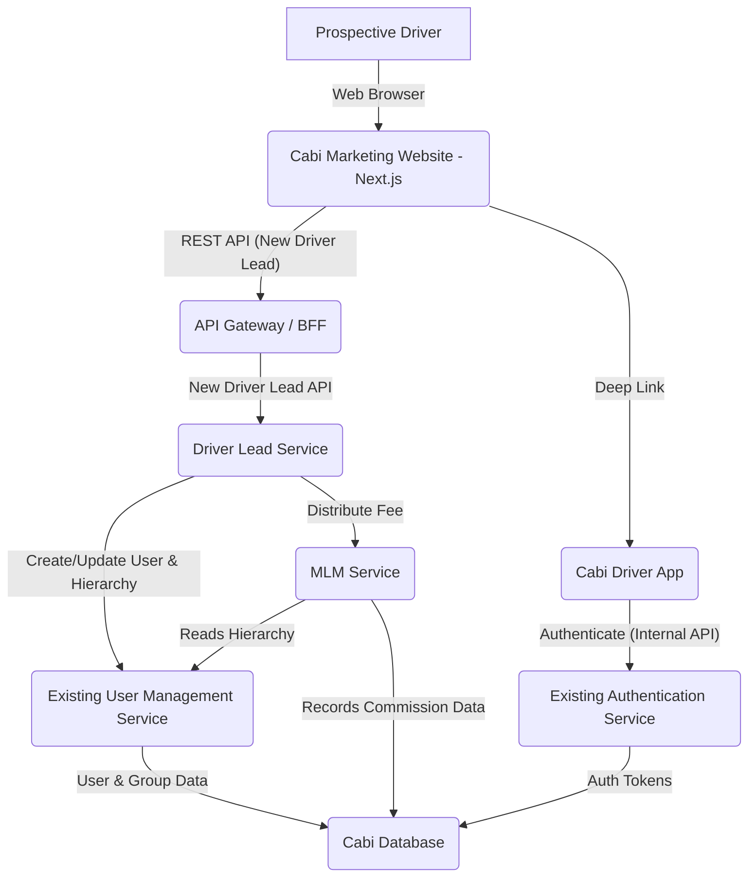

# 2. High Level Architecture

**Rationale:**
This section lays the architectural groundwork for the Cabi Marketing Website, integrating it within the broader Cabi ecosystem. The primary goal is to balance the specific needs of a high-performance marketing site (SEO, fast loading) with the robust, scalable backend infrastructure required for driver registration and existing Cabi services. The design emphasizes modularity, leveraging existing components where possible, and an API-first approach to ensure seamless integration and future extensibility.

## 2.1. Technical Summary
The Cabi Marketing Website will employ a hybrid architectural approach, combining a performant, server-side rendered (SSR) or static site generated (SSG) frontend with an existing microservices-based backend. A new Driver Lead Service will manage the initial registration funnel, integrating seamlessly with existing User Management and Authentication services. A new MLM Service will handle referral and fee distribution logic across a hierarchical driver structure. This architecture supports the PRD's goals of increased driver acquisition while enabling a scalable MLM system.

## 2.2. High Level Overview
1.  **Architectural Style:** A hybrid style, with the marketing website built using a modern web framework (e.g., Next.js) enabling SSR/SSG, integrating with the existing Cabi microservices backend. New backend logic for driver lead capture, MLM fee distribution, and driver group management will reside in dedicated services.
2.  **Repository Structure:** The marketing website and any new associated backend services will be developed within the existing Cabi monorepo, leveraging Nx workspaces for consistent tooling and code sharing across applications and libraries.
3.  **Service Architecture:** Core functionalities (User Management, Authentication) will be provided by existing Cabi backend services. A new, dedicated `Driver Lead Service` will handle the initial web-based registration process, and a new `MLM Service` will manage the driver hierarchy and fee distribution calculations.
4.  **Primary User Interaction Flow:**
    *   A prospective driver lands on the marketing website, potentially with a referral code.
    *   They browse content and initiate registration, optionally providing a referral code.
    *   Basic information is submitted to the `Driver Lead Service`.
    *   The `Driver Lead Service` interacts with the `User Management Service` to create a new "Prospect" user and link them to their referrer (upline) in the driver hierarchy.
    *   Upon successful registration and payment (handled by a separate payment service), the `Driver Lead Service` notifies the `MLM Service`.
    *   The `MLM Service` calculates and records the commission/fee distribution for the sponsor and potentially multiple upline levels based on a configurable formula.
    *   The website then deep-links the user to the Cabi Driver App to complete the full onboarding process.
5.  **Key Architectural Decisions:**
    *   **Decoupled Frontend:** The marketing website is distinct from the core mobile apps, allowing for specialized web performance optimization and independent deployment.
    *   **API-First Integration:** All new and existing services will expose well-defined RESTful APIs to ensure clear contracts and enable robust integration.
    *   **Centralized MLM Logic:** All logic related to driver hierarchy, subgroups, and commission calculations is encapsulated within a dedicated `MLM Service` to maintain separation of concerns.

## 2.3. High Level Project Diagram

## 2.4. Architectural and Design Patterns
*   **Architectural Style Patterns:**
    *   **Existing Microservices Backend with Serverless/SSR Frontend:** This approach combines the scalability and modularity of the existing microservices architecture for core business logic with the performance and SEO benefits of a server-side rendered (SSR) or statically generated (SSG) frontend for the marketing website.
        *   *Rationale:* Optimizes for both frontend performance (critical for marketing and SEO) and backend robustness, allowing independent evolution of the marketing site.
    *   **API Gateway:** Provides a unified entry point, handles cross-cutting concerns like authentication, rate limiting, and request routing.
*   **Code Organization Patterns:**
    *   **Repository Pattern:** Applied within backend services to abstract data access logic.
        *   *Rationale:* Promotes domain-driven design, enhances testability, and provides flexibility for future data storage changes.
    *   **Modular Design (Frontend & Backend):** Organize the marketing website and new backend services into cohesive, loosely coupled modules.
        *   *Rationale:* Improves maintainability, facilitates collaboration, and allows for easier scaling of individual components.
*   **Communication Patterns:**
    *   **RESTful APIs:** The primary mode of synchronous communication between the marketing website (frontend) and backend services.
        *   *Rationale:* A widely adopted standard, easy to consume, and well-suited for request-response interactions.
    *   **Event-Driven Communication (Internal Backend):** For asynchronous interactions and updates between backend services (e.g., `Driver Lead Service` publishing a `DriverRegistered` event, which the `MLM Service` subscribes to).
        *   *Rationale:* Decouples services, improves system responsiveness, and supports eventual consistency for background processes, aligning with microservice best practices.
