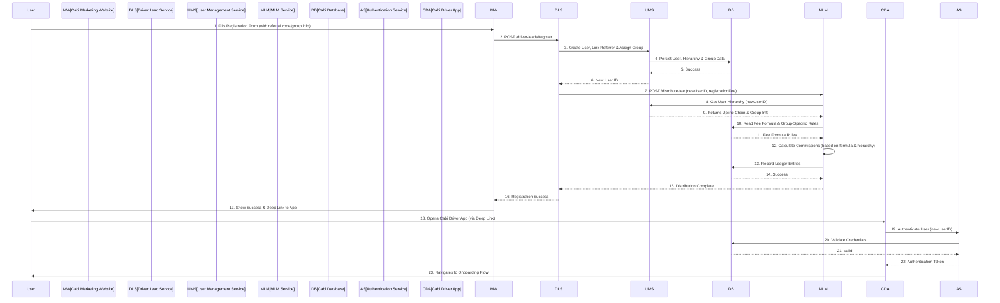

# 7. Core Workflows

**Rationale:**
This section illustrates key system workflows using sequence diagrams to clarify component interactions.

## 7.1. Driver Registration & Commission Workflow

This diagram outlines the refined user journey, including the MLM commission calculation and driver group assignment.

