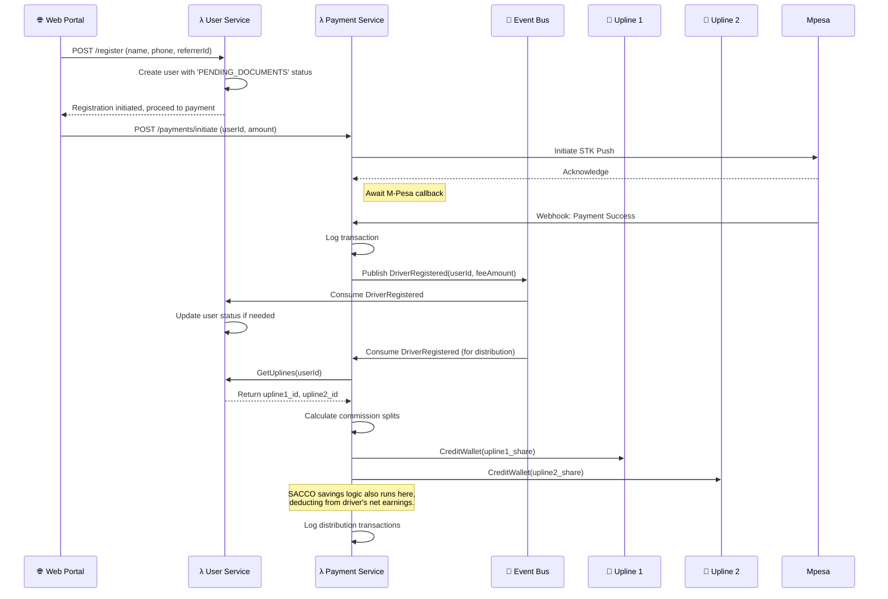

# CABI Architecture Document

## 1. Introduction

This document outlines the overall project architecture for CABI, including backend systems, shared services, and non-UI specific concerns. Its primary goal is to serve as the guiding architectural blueprint for AI-driven development, ensuring consistency and adherence to chosen patterns and technologies.

**Relationship to Frontend Architecture:**
This project includes significant user interfaces for the Passenger and Driver apps. The `front-end-spec.md` details the UI/UX design and user flows. A separate `front-end-architecture.md` will be created to detail the frontend-specific design, which MUST be used in conjunction with this document. Core technology stack choices documented herein (see "Tech Stack") are definitive for the entire project, including any frontend components.

### 1.1. Starter Template or Existing Project

N/A. No starter template or existing project was specified in the `prd.md` or `brief.md`. This architecture is designed for a greenfield project. A monorepo structure managed by **Nx** is recommended to facilitate code sharing and coordinated deployments from the outset.

### 1.2. Change Log

| Date | Version | Description | Author |
| :--- | :--- | :--- | :--- |
| *Initial Draft* | 1.0 | Initial full-stack architecture based on PRD and UI/UX Spec. | Gemini (Architect) |

## 2. High Level Architecture

### 2.1. Technical Summary

The CABI platform will be built on a **serverless, event-driven microservices architecture** hosted on Amazon Web Services (AWS). This approach is chosen to meet the project's goals of scalability, cost-efficiency, and resilience. The system is composed of distinct services (e.g., User, Ride, Payment) that communicate asynchronously via message queues and pub/sub topics. This decouples complex domains like the MLM referral engine from the core real-time ride-hailing experience. The frontend applications (Passenger and Driver) will be built using React Native, communicating with the backend via a secure API Gateway. This architecture supports the PRD's goals by providing a scalable foundation for growth, ensuring high availability for critical safety features, and allowing for independent evolution of different business functionalities.

### 2.2. High Level Overview

1.  **Architectural Style**: The system employs an **Event-Driven Microservices** architecture using serverless technologies. Core business events (e.g., `RideRequested`, `TripCompleted`, `DriverRegistered`) will be published to an event bus (AWS SNS/SQS), triggering downstream processing in a decoupled manner. This is ideal for handling asynchronous tasks like commission distribution, badge assignments, and notifications.
2.  **Repository Structure**: A **Monorepo** managed with **Nx** is selected. This will contain the mobile apps, backend services, shared libraries (types, utils), and infrastructure-as-code definitions. This simplifies dependency management, promotes code reuse, and streamlines CI/CD for a small-to-medium-sized team.
3.  **Service Architecture**: The backend is divided into several distinct microservices, each with its own data store and responsibilities. This isolates failures and allows services to be scaled independently. Key services include: `User & MLM`, `Ride`, `Payment`, `Notification`, and `SOS`.
4.  **Primary User Interaction Flow**: A passenger requests a ride via the mobile app. The request hits the **API Gateway**, which routes it to the **Ride Service**. The Ride Service finds nearby drivers and publishes a `RideOffered` event. The **Notification Service** consumes this event and sends push notifications to drivers. A driver accepts, and the **Ride Service** manages the trip lifecycle, tracking locations via WebSocket. Upon completion, the Ride Service publishes a `TripCompleted` event, which triggers the **Payment Service** to handle the M-Pesa transaction and the **User Service** to handle ratings and badge evaluations.
5.  **Key Architectural Decisions**:
    *   **Serverless-First**: Utilizing AWS Lambda for compute minimizes operational overhead and costs, as we only pay for execution time.
    *   **Managed Services**: Leveraging AWS-managed services like DynamoDB, SQS, SNS, and API Gateway reduces maintenance burden and provides high availability out-of-the-box.
    *   **Real-time Communication via WebSockets**: API Gateway's WebSocket support will be used for live location tracking and SOS audio streaming, providing a persistent connection between clients and the backend.

### 2.3. High Level Project Diagram

```mermaid
graph TD
    subgraph "User-Facing Applications"
        PassengerApp[📱 Passenger App <br>(Flutter) <br><i>Core ride & engagement</i>];
        DriverApp[📱 Driver App <br>(Flutter) <br><i>Core ride & engagement</i>];
        UserPortal[🌐 User Portal <br>(Next.js) <br><i>Onboarding, Blog, Info</i>];
        SaccoPortal[🏦 SACCO Portal <br>(Next.js) <br><i>Driver Savings Mgmt</i>];
        AdminPanel[🔐 Admin Panel <br>(React) <br><i>Internal Operations</i>];
    end

    subgraph "AWS Cloud"
        APIGateway[🌐 API Gateway <br>(REST & WebSocket)];

        subgraph "Backend Microservices (AWS Lambda)"
            UserService[λ User & MLM Service];
            RideService[λ Ride Service];
            PaymentService[λ Payment Service];
            NotificationService[λ Notification Service];
            SOSService[λ SOS Service];
            AdminService[λ Admin Service];
        end

        subgraph "Data Stores"
            UserDB[(🗄️ DynamoDB <br> Users, Referrals)];
            RideDB[(🗄️ DynamoDB <br> Rides, Locations)];
            PaymentDB[(🗄️ DynamoDB <br> Transactions)];
            AdminDB[(🗄️ Aurora Serverless <br> Logs, Roles)];
        end

        subgraph "Event Bus & Messaging"
            EventBus(📢 SNS/SQS);
        end

        subgraph "Storage"
            S3[📦 S3 Bucket <br> Documents, Audio];
        end
    end

    subgraph "External Services"
        Mpesa[🏦 M-Pesa API];
        GoogleMaps[🗺️ Google Maps API <br>(Geocoding, Routes)];
        SMSGateway[💬 SMS Gateway <br>(e.g., Twilio)];
    end

    PassengerApp --> APIGateway;
    DriverApp --> APIGateway;
    UserPortal --> APIGateway;
    SaccoPortal --> APIGateway;
    AdminPanel --> APIGateway;

    APIGateway --> UserService;
    APIGateway --> RideService;
    APIGateway --> PaymentService;
    APIGateway --> SOSService;
    APIGateway --> AdminService;

    UserService --> UserDB;
    RideService --> RideDB;
    PaymentService --> PaymentDB;
    AdminService --> AdminDB;

    UserService -- Publishes Events --> EventBus;
    RideService -- Publishes Events --> EventBus;
    PaymentService -- Publishes Events --> EventBus;
    SOSService -- Publishes Events --> EventBus;

    EventBus -- Triggers --> NotificationService;
    EventBus -- Triggers --> UserService;
    EventBus -- Triggers --> PaymentService;

    NotificationService --> SMSGateway;
    NotificationService -- Push Notifications --> PassengerApp;
    NotificationService -- Push Notifications --> DriverApp;

    PaymentService --> Mpesa;
    RideService --> GoogleMaps;
    UserService --> S3;
    SOSService --> S3;
```

### 2.4. Architectural and Design Patterns

- **Microservices Architecture:** The system is decomposed into small, independent services. - _Rationale:_ This isolates the complex MLM logic from the core ride-hailing functionality, allows for independent scaling and deployment, and improves fault isolation, which is critical for a reliable ride service.
- **Event-Driven Architecture (Pub/Sub):** Services communicate through asynchronous events using AWS SNS (for fanning out events) and SQS (for durable queues). - _Rationale:_ This decouples services, ensuring that the failure of a non-critical service (e.g., badge assignment) does not impact the core ride-hailing flow. It also enables scalable, asynchronous processing.
- **Serverless-First:** Compute logic is primarily hosted on AWS Lambda. - _Rationale:_ This aligns with the goal of cost-efficiency by paying only for what is used, eliminates server management overhead, and provides automatic scaling to handle fluctuating demand in ride requests.
- **Database per Service:** Each microservice owns its data and accesses it through a private data store (primarily DynamoDB). - _Rationale:_ This enforces service autonomy and loose coupling. It prevents a single database from becoming a bottleneck and allows each service to choose the database technology best suited to its needs.
- **API Gateway:** A single, unified entry point for all client applications. - _Rationale:_ This pattern simplifies client-side logic, provides a centralized place for authentication and rate limiting, and abstracts the underlying microservice structure from the clients.
- **Repository Pattern:** Data access logic within each service will be abstracted behind a repository interface. - _Rationale:_ This decouples the business logic from the specific database implementation (e.g., DynamoDB), making the code more testable and easier to maintain or migrate in the future.

## 3. Tech Stack

The following technology stack is selected as the definitive choice for the CABI project. All development must adhere to these selections and versions.

### 3.1. Cloud Infrastructure

- **Provider:** Amazon Web Services (AWS)
- **Key Services:** AWS Lambda, API Gateway (REST & WebSocket), SQS, SNS, DynamoDB, S3, Cognito, IAM, CloudFormation, Aurora Serverless v2 (for Admin logging).
- **Deployment Regions:** `af-south-1` (Cape Town) to minimize latency for the Kenyan market.

### 3.2. Technology Stack Table

| Category | Technology | Version | Purpose | Rationale |
| :--- | :--- | :--- | :--- | :--- |
| **Language** | TypeScript | `5.4.x` | Primary language for all code (backend & frontend) | Provides strong typing to reduce errors, excellent tooling, and consistency across the stack. |
| **Monorepo Tool** | Nx | `19.x.x` | Manage the monorepo, dependencies, and build scripts | Excellent support for mixed-app types (Flutter, Node.js), powerful caching, and structured code sharing. |
| **Mobile Framework** | Flutter | `3.22.x` | Cross-platform mobile app development | High-performance, single codebase for iOS, Android, and Web. Excellent UI control and native-like performance. |
| **Backend Runtime** | Node.js | `20.x` (LTS) | JavaScript runtime for AWS Lambda functions | Excellent performance for I/O-bound tasks, massive ecosystem, and uses the same language as the frontend. |
| **Backend Framework** | NestJS | `10.x.x` | Framework for building backend Lambda functions | Provides a structured, modular architecture with DI, decorators, and TypeScript support, ideal for microservices. |
| **Database (Primary)** | Amazon DynamoDB | N/A | NoSQL database for core services (Users, Rides, etc.) | Infinitely scalable, low-latency, pay-per-request model fits perfectly with a serverless architecture. |
| **Database (Admin)** | AWS Aurora Serverless v2 (PostgreSQL) | `15.x` | Relational database for admin audit logs & RBAC | Better suited for the relational nature of roles/permissions and complex queries required for audit trails. |
| **Real-time API** | AWS API Gateway WebSockets | N/A | Real-time communication for location tracking, SOS | Managed service that integrates seamlessly with Lambda for handling persistent connections. |
| **Authentication** | Amazon Cognito | N/A | User authentication and identity management | Provides a secure, managed user pool, handling sign-up, login, OTP, and MFA. Integrates with API Gateway. |
| **Infrastructure as Code** | AWS CloudFormation (or CDK) | N/A | Define and deploy AWS infrastructure | Enables repeatable, automated, and version-controlled infrastructure setup. CDK is preferred for TypeScript integration. |
| **UI Component Library** | Material 3 (via Flutter SDK) | N/A | Base component library for mobile apps | Provides a modern, comprehensive set of widgets following Material Design guidelines, ensuring a consistent and high-quality UI. |

## 4. Data Models

These are the core conceptual data models. They will be implemented as DynamoDB tables with appropriate partition and sort keys.

### 4.1. User Model

**Purpose:** Represents all users in the system, including passengers, drivers, and admins. Stores profile information, authentication details, and referral network links.

**Key Attributes:**
- `userId` (PK): `string` - Unique identifier (e.g., UUID).
- `phone`: `string` - User's phone number (used for login).
- `fullName`: `string` - User's full name.
- `passwordHash`: `string` - Hashed password.
- `userType`: `enum` ('PASSENGER', 'DRIVER').
- `status`: `enum` ('ACTIVE', 'PENDING_DOCUMENTS', 'PENDING_APPROVAL', 'REQUIRES_CORRECTION', 'REJECTED', 'SUSPENDED').
- `rating`: `number` - Average rating (defaults to 3).
- `upline1_userId`: `string` - ID of the direct referrer.
- `upline2_userId`: `string` - ID of the referrer's referrer.
- `createdAt`: `timestamp`.

**Relationships:**
- A User can be the `upline1_userId` for many other Users.
- A User can have many `Badges` (stored in a separate BadgeAssignment table).
- A User can have many `Trips` (as either passenger or driver).

### 4.2. DriverProfile Model

**Purpose:** Stores driver-specific information, linked to a User model.

**Key Attributes:**
- `userId` (PK): `string` - Foreign key to the User model.
- `licenseNumber`: `string`.
- `nationalId`: `string`.
- `vehicleDetails`: `object` - { make, model, year, licensePlate }.
- `documents`: `array` of objects - [{ type, url, status, rejectionReason }].

**Relationships:**
- One-to-one relationship with a User of type 'DRIVER'.

### 4.3. Trip Model

**Purpose:** Represents a single ride from request to completion.

**Key Attributes:**
- `tripId` (PK): `string` - Unique identifier.
- `passengerId`: `string` - FK to User.
- `driverId`: `string` - FK to User.
- `status`: `enum` ('REQUESTED', 'ACCEPTED', 'EN_ROUTE_TO_PICKUP', 'ARRIVED_AT_PICKUP', 'IN_PROGRESS', 'COMPLETED', 'CANCELED').
- `pickupLocation`: `object` - { lat, lon, address }.
- `destinationLocation`: `object` - { lat, lon, address }.
- `fare`: `number` - Final fare amount.
- `paymentStatus`: `enum` ('PENDING', 'PAID', 'FAILED').
- `createdAt`: `timestamp`.
- `completedAt`: `timestamp`.

**Relationships:**
- Belongs to one `passengerId` and one `driverId`.

### 4.4. Transaction Model

**Purpose:** Logs all financial movements, including registration fees, fares, commissions, and payouts.

**Key Attributes:**
- `transactionId` (PK): `string`.
- `tripId`: `string` (optional) - FK to Trip if it's a fare transaction.
- `fromUserId`: `string` - User who paid.
- `toUserId`: `string` - User/System who received.
- `amount`: `number`.
- `type`: `enum` ('REGISTRATION_FEE', 'FARE_PAYMENT', 'COMMISSION_UPLINE1', 'COMMISSION_UPLINE2', 'DRIVER_EARNING', 'SOS_PENALTY').
- `status`: `enum` ('COMPLETED', 'PENDING', 'FAILED').
- `timestamp`: `timestamp`.

**Relationships:**
- Can be linked to a `Trip`.

### 4.5. BlogPost Model

**Purpose:** Represents a single blog article for community engagement and news updates. Managed via the Admin Panel and displayed in the mobile apps.

**Key Attributes:**
- `postId` (PK): `string` - Unique identifier for the post.
- `title`: `string` - The title of the blog post.
- `content`: `string` - The full content of the post (can be HTML from a rich text editor).
- `summary`: `string` - A short summary for list views.
- `featuredImageUrl`: `string` - URL for the post's main image.
- `authorName`: `string` - Name of the author.
- `status`: `enum` ('DRAFT', 'PUBLISHED').
- `publishedAt`: `timestamp` - The date the post was published, used for sorting.
- `createdAt`: `timestamp`.
- `updatedAt`: `timestamp`.

**Relationships:**
- None directly to other core models. This is a content entity.

## 5. Components

The backend is broken down into logical microservice components.

### 5.1. User & MLM Service

**Responsibility:** Manages all aspects of user identity, profiles, authentication (via Cognito), and the multi-level marketing (MLM) referral network. Handles driver registration state machine, badge assignment logic, and viewing referral earnings.

**Key Interfaces:**
- `POST /users/register` (Passenger/Driver)
- `POST /users/login`
- `GET /users/profile` - Returns user profile, including the `requiresBiometricCheck` flag.
- `PUT /users/profile`
- `POST /users/verify-biometric` - Called on successful biometric scan to clear the check flag.
- `POST /users/biometric-failed` - Called after 3 failed attempts to suspend the user account.
- `GET /users/network` (View referrals and earnings)
- Subscribes to `TripCompleted` events to calculate and assign referral commissions.

**Dependencies:** Cognito, UserDB, EventBus, S3 (for document uploads).

**Technology Stack:** NestJS on Node.js Lambda.

### 5.2. Ride Service

**Responsibility:** Manages the core ride-hailing lifecycle. This includes handling ride requests, matching drivers to passengers (geospatial queries), tracking live locations, and managing trip state transitions.

**Key Interfaces:**
- `POST /rides/request`
- `POST /rides/{id}/accept`
- `POST /rides/{id}/complete`
- WebSocket endpoint for live location updates: `wss://api.example.com/locations`

**Dependencies:** RideDB, Google Maps API, EventBus.

**Technology Stack:** NestJS on Node.js Lambda.

### 5.3. Payment Service

**Responsibility:** Integrates with the M-Pesa API to process all payments. Handles driver registration fees, trip fares, and distributes commissions and earnings based on events from the EventBus.

**Key Interfaces:**
- `POST /payments/initiate` (For M-Pesa STK push)
- Subscribes to `DriverRegistered` and `TripPaid` events to trigger fee/commission distribution and SACCO savings logic.

**Dependencies:** M-Pesa API, PaymentDB, EventBus.

**Technology Stack:** NestJS on Node.js Lambda.

### 5.4. Notification Service

**Responsibility:** A stateless service that consumes events and sends notifications to users via the appropriate channel (Push Notification, SMS).

**Key Interfaces:**
- Subscribes to events like `RideOffered`, `DriverAssigned`, `TripCompleted`, `SOSActivated`.

**Dependencies:** SMS Gateway (Twilio), Firebase Cloud Messaging (FCM) / Apple Push Notification Service (APNS), EventBus.

**Technology Stack:** Node.js Lambda (plain, no framework needed).

### 5.5. SOS Service

**Responsibility:** Handles all logic for the critical SOS feature. Receives SOS alerts, initiates audio streaming from the driver's device to S3, identifies nearby drivers, and triggers high-priority notifications.

**Key Interfaces:**
- `POST /sos/activate`
- WebSocket endpoint for live audio streaming: `wss://api.example.com/sos-audio`

**Dependencies:** S3, EventBus, RideDB (for location data).

**Technology Stack:** NestJS on Node.js Lambda.

### 5.6. Admin Service

**Responsibility:** Provides all backend functionality for the Admin Panel. This includes managing driver approvals, configuring MLM and promotional settings, handling role-based access control (RBAC), and managing content like blog posts.

**Key Interfaces:**
- `POST /admin/drivers/{id}/approve`
- `POST /admin/drivers/{id}/reject`
- `PUT /admin/config/mlm` (Manages MLM splits and SACCO savings rate)
- `GET /admin/permissions` - List all permissions.
- `POST /admin/permissions` - Create a new permission.
- `PUT /admin/permissions/{permissionId}` - Update a permission.
- `GET /admin/roles` - List all roles.
- `POST /admin/roles` - Create a new role.
- `PUT /admin/roles/{roleId}` - Update a role and its assigned permissions.
- `GET /admin/users` - List admin users.
- `PUT /admin/users/{userId}/roles` - Assign/update roles for an admin user.
- `PUT /admin/users/{userId}/permissions` - Assign or revoke a specific permission for a user, overriding roles.
- `POST /admin/users/{userId}/unsuspend` - Manually unsuspend a user account that was locked (e.g., due to biometric failure).

**Dependencies:** AdminDB (Aurora), UserDB, EventBus, BlogDB.

**Technology Stack:** NestJS on Node.js Lambda.

### 5.7. Component Diagram

```mermaid
C4Container
    title Component Diagram for CABI Backend

    Person(passenger, "Passenger", "Uses the mobile app")
    Person(driver, "Driver", "Uses the mobile app")
    System_Ext(mpesa, "M-Pesa API", "Payment Gateway")
    System_Ext(googleMaps, "Google Maps", "Mapping & Geolocation")
    System_Ext(sms, "SMS Gateway", "OTP & Alerts")

    System_Boundary(cabi, "CABI Platform") {
        Component(api, "API Gateway", "REST/WebSocket", "Single entry point for all clients")

        ComponentDb(userDb, "User DB", "DynamoDB", "Stores user profiles, referral tree")
        Component(userService, "User & MLM Service", "AWS Lambda", "Manages users, auth, referrals, badges")

        ComponentDb(rideDb, "Ride DB", "DynamoDB", "Stores trips, locations")
        Component(rideService, "Ride Service", "AWS Lambda", "Manages ride lifecycle, matching, tracking")

        ComponentDb(paymentDb, "Payment DB", "DynamoDB", "Stores transactions")
        Component(paymentService, "Payment Service", "AWS Lambda", "Processes payments and commission splits")

        Component(notificationService, "Notification Service", "AWS Lambda", "Sends SMS and push notifications")
        Component(sosService, "SOS Service", "AWS Lambda", "Handles emergency alerts and audio streaming")

        Component(eventBus, "Event Bus", "SNS/SQS", "Decouples services via pub/sub")
    }

    Rel(passenger, api, "Requests Ride, Manages Profile")
    Rel(driver, api, "Accepts Ride, Manages Profile")

    Rel(api, userService, "Auth, Profile, Network")
    Rel(api, rideService, "Ride Requests, Location Updates")
    Rel(api, paymentService, "Payment Initiation")
    Rel-R(api, sosService, "SOS Alerts")

    Rel(userService, userDb, "Reads/Writes")
    Rel(rideService, rideDb, "Reads/Writes")
    Rel(paymentService, paymentDb, "Reads/Writes")

    Rel(rideService, googleMaps, "Uses for routing")
    Rel(paymentService, mpesa, "Uses for payments")
    Rel(notificationService, sms, "Uses for SMS")

    Rel(userService, eventBus, "Publishes UserRegistered")
    Rel(rideService, eventBus, "Publishes RideRequested, TripCompleted")
    Rel(paymentService, eventBus, "Publishes PaymentSuccess")

    Rel(eventBus, notificationService, "Subscribes to events")
    Rel(eventBus, paymentService, "Subscribes to events")
    Rel(eventBus, userService, "Subscribes to events")
```

## 6. External APIs

### 6.1. M-Pesa API

- **Purpose:** To handle all mobile money payments, including registration fees and trip fares. The STK Push mechanism is critical.
- **Documentation:** Safaricom Developer Portal
- **Base URL(s):** `https://api.safaricom.co.ke`
- **Authentication:** OAuth 2.0 with Consumer Key and Secret.
- **Rate Limits:** To be confirmed from documentation, but must be handled with retries and a circuit breaker pattern.
- **Key Endpoints Used:**
  - `POST /mpesa/stkpush/v1/processrequest` - To initiate an STK push to the user's phone for payment confirmation.
  - `POST /mpesa/stkpushquery/v1/query` - To check the status of a transaction.
- **Integration Notes:** The Payment Service will encapsulate all interactions with the M-Pesa API. A robust error handling and retry mechanism is required to handle network issues and transaction timeouts.

### 6.2. Google Maps Platform API

- **Purpose:** To provide geocoding (address search), route planning, distance calculation, and map tiles for the client applications.
- **Documentation:** Google Maps Platform Documentation
- **Base URL(s):** `https://maps.googleapis.com`
- **Authentication:** API Key.
- **Rate Limits:** Subject to Google's pricing and usage limits. Caching of geocoding results should be implemented to reduce costs.
- **Key Endpoints Used:**
  - `Places API` - For address autocomplete and search.
  - `Directions API` - To calculate routes and estimate travel time/distance for fare estimation.
  - `Distance Matrix API` - To find distances between drivers and passengers.
- **Integration Notes:** The Ride Service will use these APIs for fare calculation and routing. The client apps will use the Maps SDK for displaying the map.

### 6.3. SMS Gateway (e.g., Twilio)

- **Purpose:** To send One-Time Passwords (OTPs) for phone number verification during registration and for password resets. Also used for critical alerts (e.g., SOS upline notification).
- **Documentation:** (Example: Twilio Docs)
- **Base URL(s):** `https://api.twilio.com`
- **Authentication:** Account SID and Auth Token.
- **Rate Limits:** Dependent on the provider plan.
- **Key Endpoints Used:**
  - `POST /2010-04-01/Accounts/{AccountSid}/Messages.json` - To send an SMS.
- **Integration Notes:** The Notification Service will be the sole interactor with this API. It will be triggered by events like `UserRequiresOTP`.

### 6.4. Content Service (Internal)

- **Purpose:** To serve content like blog posts to the user-facing portals and mobile apps.
- **Key Endpoints Used:**
  - `GET /posts` - Returns a list of published blog posts.
  - `GET /posts/{postId}` - Returns the full content of a single post.
- **Integration Notes:** This service will read from the `cabi-blog-posts` DynamoDB table, which is written to by the Admin Service.

### 6.5. SACCO Service (Internal)

- **Purpose:** To manage driver savings accounts.
- **Key Endpoints Used:**
  - `GET /drivers/me/sacco` - Returns a driver's SACCO balance and transaction history.
- **Integration Notes:** This service subscribes to `TripCompleted` events to process SACCO deductions from driver earnings.


## 7. Core Workflows

### 7.1. Driver Registration & Fee Distribution

This sequence diagram illustrates the flow for a new driver registering and the subsequent distribution of the registration fee, as detailed in PRD stories 1.3 and 2.3.



### 7.2. SOS Alert Activation

This diagram shows the critical path for an SOS alert, from the driver's action to notifying nearby drivers and the admin panel, as per PRD stories 1.10 and 1.11.

```mermaid
sequenceDiagram
    participant DriverApp as 📱 Driver App
    participant SOSService as λ SOS Service
    participant EventBus as 📢 Event Bus
    participant NotificationService as λ Notification Service
    participant AdminPanel as 💻 Admin Panel
    participant NearbyDriverApp as 📱 Nearby Driver App

    DriverApp->>SOSService: POST /sos/activate (via API Gateway)
    Note right of DriverApp: App starts streaming audio to<br>WebSocket endpoint handled by SOSService
    SOSService->>SOSService: Store alert details, get live location
    SOSService->>EventBus: Publish SOSActivated(driverId, location, tripId)

    EventBus->>NotificationService: Consume SOSActivated
    NotificationService->>AdminPanel: Push high-priority alert (WebSocket)
    NotificationService->>NotificationService: Get driver's upline contacts
    NotificationService->>SMSGateway: Send SMS to Upline 1 & 2

    EventBus->>SOSService: Consume SOSActivated (self-trigger)
    SOSService->>RideService: FindNearbyDrivers(location)
    RideService-->>SOSService: List of nearby driver IDs

    loop for each nearby driver
        SOSService->>EventBus: Publish NotifyDriverOfSOS(nearbyDriverId, sosLocation)
    end

    EventBus->>NotificationService: Consume NotifyDriverOfSOS
    NotificationService->>NearbyDriverApp: Send un-dismissible push notification

### 7.3. View Blog Posts

This diagram illustrates the flow for a user on a mobile app viewing the list of blog posts and reading a specific one, as per PRD Story 3.4.

```mermaid
sequenceDiagram
    participant MobileApp as 📱 Mobile App
    participant APIGateway as 🌐 API Gateway
    participant UserService as λ User & MLM Service
    participant BlogDB as 🗄️ Blog DB (DynamoDB)

    MobileApp->>APIGateway: GET /posts
    APIGateway->>UserService: Invoke with request
    note right of UserService: Query for posts with status='PUBLISHED'
    UserService->>BlogDB: Query(status-publishedAt-index, status='PUBLISHED')
    BlogDB-->>UserService: Return list of post summaries
    UserService-->>APIGateway: Return post list
    APIGateway-->>MobileApp: [{postId, title, summary, ...}]

    MobileApp->>MobileApp: User taps on a specific post
    MobileApp->>APIGateway: GET /posts/{postId}
    APIGateway->>UserService: Invoke with request for specific post
    UserService->>BlogDB: GetItem(postId)
    BlogDB-->>UserService: Return full post content
    UserService-->>APIGateway: Return full post
    APIGateway-->>MobileApp: {postId, title, content, ...}
```

    EventBus->>NotificationService: Consume NotifyDriverOfSOS
    NotificationService->>NearbyDriverApp: Send un-dismissible push notification
```

## 8. Database Schema

The primary database will be DynamoDB, leveraging its NoSQL, key-value structure for scalability. The schema design focuses on access patterns.

**Users Table (`cabi-users`)**
*   **Partition Key (PK):** `userId` (string)
*   **Attributes:** `phone`, `fullName`, `passwordHash`, `userType`, `status`, `rating`, `upline1_userId`, `upline2_userId`, `createdAt`.
*   **Global Secondary Index (GSI):**
    *   `phone-index`: PK=`phone`. Allows for efficient lookup by phone number during login.

**Trips Table (`cabi-trips`)**
*   **Partition Key (PK):** `tripId` (string)
*   **Attributes:** `passengerId`, `driverId`, `status`, `pickupLocation`, `destinationLocation`, `fare`, `paymentStatus`, `createdAt`, `completedAt`.
*   **Global Secondary Indexes (GSIs):**
    *   `passengerId-createdAt-index`: PK=`passengerId`, SK=`createdAt`. To query a passenger's trip history.
    *   `driverId-createdAt-index`: PK=`driverId`, SK=`createdAt`. To query a driver's trip history.

**Transactions Table (`cabi-transactions`)**
*   **Partition Key (PK):** `transactionId` (string)
*   **Attributes:** `tripId`, `fromUserId`, `toUserId`, `amount`, `type`, `status`, `timestamp`.
*   **Global Secondary Index (GSI):**
    *   `toUserId-timestamp-index`: PK=`toUserId`, SK=`timestamp`. To query a user's earnings over time.

**Blog Posts Table (`cabi-blog-posts`)**
*   **Partition Key (PK):** `postId` (string)
*   **Attributes:** `title`, `content`, `summary`, `featuredImageUrl`, `authorName`, `status`, `publishedAt`, `createdAt`, `updatedAt`.
*   **Global Secondary Index (GSI):**
    *   `status-publishedAt-index`: PK=`status`, SK=`publishedAt`. To efficiently query for all published posts, sorted by publication date.

**Admin RBAC/Logs Table (`cabi-admin-db` - PostgreSQL in Aurora)**
*   **`roles` table:** `role_id` (PK), `role_name`.
*   **`permissions` table:** `permission_id` (PK), `permission_key`, `description`.
*   **`role_permissions` table:** `role_id` (FK), `permission_id` (FK).
*   **`admin_users` table:** `user_id` (PK), `username`, `password_hash`.
*   **`admin_user_roles` table:** `user_id` (FK), `role_id` (FK).
*   **`admin_user_permissions` table:** `user_id` (FK), `permission_id` (FK), `assignment_type` (enum: 'GRANT', 'REVOKE'). This table handles direct permission grants or revokes, overriding role-based permissions.
*   **`audit_logs` table:** `log_id` (PK), `admin_user_id`, `action`, `details`, `ip_address`, `timestamp`.

## 9. Source Tree

The project will use a monorepo structure managed by Nx to organize the various applications and libraries.

```plaintext
cabi-monorepo/
├── apps/                   # User-facing applications
│   ├── passenger-app/      # Flutter app for passengers (core experience)
│   ├── driver-app/         # Flutter app for drivers (core experience)
│   ├── web-portal/         # Public-facing web app (Onboarding, Blog, etc.)
│   └── admin-panel/        # Secure internal admin tool
├── libs/
│   ├── backend/
│   │   ├── user-service/       # NestJS microservice for User & MLM
│   │   ├── ride-service/       # NestJS microservice for Rides
│   │   ├── payment-service/    # NestJS microservice for Payments
│   │   ├── notification-service/ # Lambda function for Notifications
│   │   ├── sos-service/        # NestJS microservice for SOS
│   │   └── admin-service/      # NestJS service for Admin APIs
│   ├── shared/
│   │   ├── types/            # Shared TypeScript types and interfaces
│   │   └── utils/            # Shared utility functions
│   └── infrastructure/
│       └── aws/              # AWS CDK/CloudFormation stacks
├── tools/                    # Build/deployment scripts
├── nx.json
├── package.json
└── tsconfig.base.json
```

## 10. Infrastructure and Deployment

### 10.1. Infrastructure as Code

- **Tool:** AWS Cloud Development Kit (CDK) with TypeScript.
- **Location:** `libs/infrastructure/aws/`
- **Approach:** Each microservice will have its own CDK stack definition, which includes its Lambda functions, API Gateway routes, DynamoDB tables, and IAM roles. A root stack will compose the individual service stacks and define shared resources like the EventBus (SNS/SQS) and Cognito User Pool.

### 10.2. Deployment Strategy

- **Strategy:** Continuous Integration & Continuous Deployment (CI/CD).
- **CI/CD Platform:** GitHub Actions.
- **Pipeline Configuration:** `.github/workflows/deploy.yml`
- **Workflow:**
  1.  On push to `main` branch, the pipeline is triggered.
  2.  Nx's `affected` command determines which apps/libs have changed.
  3.  Run linting and tests for affected projects.
  4.  Build and package the changed Lambda functions and client apps.
  5.  Deploy the updated CDK stacks to a `staging` environment.
  6.  Run E2E tests against the `staging` environment.
  7.  After manual approval, promote the build to the `production` environment.

### 10.3. Environments

- **development:** Local developer machine using tools like AWS SAM or Serverless Framework for local Lambda emulation.
- **staging:** A full-fledged AWS environment that mirrors production. Used for E2E testing and QA.
- **production:** The live environment serving end-users.

## 11. Security

### 11.1. Authentication & Authorization

- **Authentication:** Amazon Cognito will manage user pools. Clients will authenticate with Cognito to receive JWTs (JSON Web Tokens).
- **API Authorization:** API Gateway will be configured with a Cognito Authorizer. Every request to a protected endpoint must include a valid JWT in the `Authorization` header. The token's claims (e.g., `userId`, `userType`) will be passed to the downstream Lambda functions.
- **Admin Panel:** The admin panel will have a separate Cognito User Pool with Multi-Factor Authentication (MFA) enforced.
- **RBAC:** The flexible Role-Based Access Control system defined in the PRD will be implemented in the Admin Service, using the PostgreSQL database to store roles, permissions, and user assignments.

### 11.2. Data Protection

- **Encryption in Transit:** All communication between clients and API Gateway, and between AWS services, will be encrypted using TLS 1.2+.
- **Encryption at Rest:** All data stored in DynamoDB and S3 will be encrypted at rest using AWS KMS.
- **PII Handling:** Personally Identifiable Information (PII) will be handled with care. Access will be restricted by IAM policies. No sensitive data (passwords, PII) will ever be logged.

### 11.3. Secrets Management

- **Production:** AWS Secrets Manager will be used to store all secrets, such as third-party API keys (M-Pesa, Google Maps) and database credentials.
- **Code Requirements:** Lambda functions will be granted IAM permissions to access specific secrets from Secrets Manager at runtime. Secrets will NEVER be hardcoded or stored in environment variables.

## 12. Next Steps

1.  **Create Frontend Architecture**: Hand off this document and the `front-end-spec.md` to the Architect to create the detailed `front-end-architecture.md`. This will specify the Flutter project structure, state management (e.g., BLoC, Riverpod), and component implementation details.
2.  **Setup Project Scaffolding**: Use Nx to set up the monorepo structure as defined in the `Source Tree` section.
3.  **Begin Story Implementation**: Once the frontend architecture is complete, the Scrum Master can begin creating stories for Epic 1, starting with project setup and user registration, which can then be implemented by the development team.